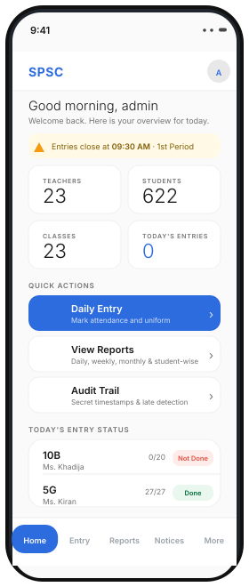
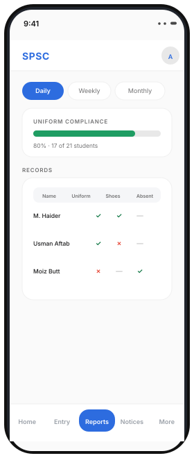
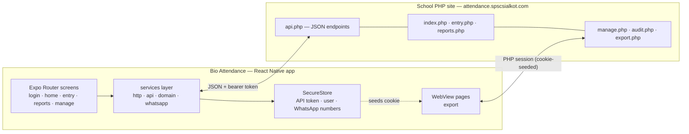
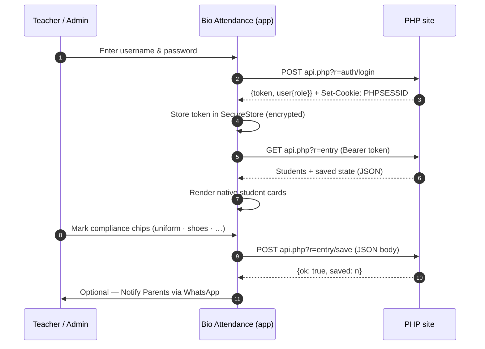

<div align="center">


# Bio Attendance — Android App

**A native Android companion for the *Daily Student Checking System* of Sialkot Public School & College.**

Built with **Expo SDK 51 · React Native 0.74 · TypeScript**, this app wraps the school's existing PHP attendance
website (`attendance.spscsialkot.com`) in a fast, design-led native shell — same session, same data, zero server changes.


</div>

---

## Table of contents

- [Screenshots](#screenshots)
- [Features](#features)
- [Face attendance](#face-attendance)
- [How it works](#how-it-works)
- [Tech stack](#tech-stack)
- [Getting started](#getting-started)
- [Build & release workflow](#build--release-workflow)
- [Project structure](#project-structure)
- [Security](#security)
- [SSL certificate note](#-ssl-certificate-note-read-this)
- [Troubleshooting](#troubleshooting)
- [License](#license)

## Screenshots

The app follows the approved **SPSC Essence** design system — a light `#FAFAFA` canvas, white 16px-radius cards with
soft diffused shadows, Inter typography, and a single primary action color (`#2D6CDF`).

| Login | Teacher / Admin Dashboard | Daily Entry | Reports |
|:---:|:---:|:---:|:---:|
|  |  |  |  |

A **full 15-screen gallery** — including the global bottom navigation, face enrollment/scanning, defaulters, fees,
notices and the Notify-Parents queue — lives in [`SCREENSHOTS.md`](SCREENSHOTS.md).

## Features

| Screen | What it does |
|---|---|
| **Login** | Native sign-in against the school's `api.php` (bearer token kept in encrypted SecureStore); remembers the username |
| **Home** | Role-aware native dashboard — bento stat grid, deadline banner, and today's per-class entry status from the API. Teachers get their class; admins see all classes plus **Audit Trail**, **Manage** and an in-app **Attendance Deadline** editor |
| **Daily Entry** | Native student cards with six three-state compliance chips (uniform · shoes · socks · haircut · nails · bag), **Mark All**, progress bar and Save. Saves through `entry/save` — the server takes the class from the token, never the request |
| **Face Attendance** | Fully on-device face check-in — enroll a student with three camera samples, then point the camera at the class. Enrolled faces are matched locally and only the recognised roll numbers are sent to `face/mark`; on finish, students who were not recognised can be marked absent in one step |
| **Notify Parents** | After a save with non-compliant students, opens a **Notify Parents** screen: per-student WhatsApp messages (`wa.me` deep links), a sequential batch queue that auto-advances on app resume, sent/pending states, and an add-number shortcut for students without a number on file |
| **WhatsApp numbers** | Stored **on-device** (SecureStore, keyed by `class:roll`) and normalized to E.164-ish `+92…` — editable from every entry card, Manage Students, and the Notify screen |
| **Manage Students / Teachers** | Native admin tools — search, class filters, add / edit / deactivate students and teachers via `manage/action` |
| **Reports** | Fully native rendering of the site's reports — **Daily / Weekly / Monthly / Student-wise / Teacher-wise** with per-checkpoint compliance bars and ✓/✗/— records tables; CSV export via the WebView pages `export.php` / `admin_export.php` |
| **Bulk Upload** | Native CSV picker → multipart upload to `manage/upload` with per-row result feedback |
| **Audit Trail** | `audit` (admin only) — secret entry timestamps, class/teacher/date filters, on-time vs late detection |
| **Profile** | Avatar, full name, assigned class, late-warning count (admin: audit late/backdated + late rate), logout |

## Face attendance

Face check-in uses the same pipeline as the Flutter reference project in `Students Bio Attendance`:

```
camera → ML Kit face detection → 30% padded crop → 112×112 RGB
       → MobileFaceNet (TFLite, 192-d) → L2-normalised embedding
       → cosine similarity against the class roster → threshold gate
```

- **Enrollment** (`app/face/enroll.tsx`) — three samples per student, stored as vectors in
  `students.face_embedding_json`. Re-enrolling replaces the old samples; the trash button clears them.
- **Scanning** (`app/face/scan.tsx`) — the camera takes a frame roughly every second, matches the largest face, and
  marks a student present the first time they are recognised. Present students are highlighted; **Finish & save**
  writes the session through `face/mark`.
- **Attendance rules** — a matched student gets `is_absent = 0`. If a teacher already saved a full daily entry, only
  `is_absent` is touched: uniform checks and remarks are never overwritten. On **Finish & save** the teacher can also
  mark the students who were not recognised as absent; that only creates records for students with no entry yet, so
  an existing manual entry is never replaced.
- **Privacy** — photos and crops are deleted from the cache immediately; only the mathematical embeddings are
  uploaded. Face data lives on the `students` row and is removed with **Remove face data**.
- **Threshold** — cosine similarity, default **0.52**. Tune it without an app rebuild:

  ```sql
  INSERT INTO settings (setting_key, setting_value) VALUES ('face_match_threshold', '0.55')
    ON DUPLICATE KEY UPDATE setting_value = VALUES(setting_value);
  ```

  Raise it if two students get confused, lower it if genuine students are rejected.

### Server requirement

The face endpoints are part of `api.php`. On first use the server adds the storage columns itself; if the database
user cannot `ALTER`, run this once in phpMyAdmin:

```sql
ALTER TABLE students
  ADD COLUMN face_embedding_json LONGTEXT NULL,
  ADD COLUMN face_samples INT NOT NULL DEFAULT 0,
  ADD COLUMN face_enrolled_at DATETIME NULL;
```

### Rebuilding after the face feature

The pipeline is native (`@react-native-ml-kit/face-detection`, `react-native-fast-tflite`), so **Expo Go cannot run
it** and an existing APK must be rebuilt. `metro.config.js` registers `tflite` as an asset and
`assets/models/mobilefacenet.tflite` is listed in `assets/models/README.md`. See
[Native Android rebuild](#native-android-rebuild) below.

## How it works

The school site is a compact PHP app. `api.php` exposes what teachers and admins do as JSON — sign in, load and
save daily checking records (uniform, shoes, socks, haircut, nails, bag, remarks, absent), run reports, read the
audit trail, manage rosters and set the daily deadline — so the app never parses HTML. The server-rendered pages
still work unchanged for browsers, and both surfaces share `config.php` and the same database.



### Session flow

Login returns a bearer token (valid 30 days) alongside the user's real role; the token is stored in SecureStore and
sent on every API call. The response also sets a `PHPSESSID`, which the app replays and seeds into the WebView, so
the remaining browser pages (CSV export) keep the same session.



## Tech stack

| Layer | Choice |
|---|---|
| Framework | **Expo SDK 51** (React Native 0.74) |
| Language | **TypeScript** (strict) |
| Navigation | **Expo Router** (file-based tabs + stacks) |
| Networking | **axios** — JSON client with bearer token + Set-Cookie replay for the WebView |
| Secure storage | **expo-secure-store** — API token, session cookie, user, WhatsApp numbers |
| WebView | **react-native-webview** (session-seeded pages) |
| Design | Custom **SPSC Essence** tokens (`constants/theme.ts`) + Inter |
| Builds | **EAS Build** — or a local Gradle release (see below) |
| Face recognition | **ML Kit** face detection + **MobileFaceNet** TFLite (`react-native-fast-tflite`), on device |

## Getting started

### Prerequisites

- **Node.js** 18+ and npm
- Android **dev build / production build** (⚠️ *Expo Go is not supported* — the WebView session-sync uses the native
  `@react-native-cookies/cookies` module, which only exists in a real build)
- Android SDK (for local `expo run:android`), or an Expo account for EAS cloud builds

### Install

```bash
git clone <your-repo-url>
cd attendance_app
npm install
```

### Environment

```bash
cp .env.example .env        # optional — the base URL already defaults correctly
```

`EXPO_PUBLIC_BASE_URL` points the app at the school server. **Never commit `.env`** — it is git-ignored, and only
`.env.example` (a template with no secrets) is committed.

### Run a dev build

```bash
npx expo run:android        # builds + installs the dev client on a connected device/emulator
```

## Build & release workflow

Release builds are produced with **EAS Build** (see `eas.json`). Three profiles cover the lifecycle:

| Profile | Purpose | Output |
|---|---|---|
| `development` | Local dev client (fast iteration, full native modules) | debug APK |
| `preview` | Sideloadable release for teachers (internal distribution) | release **APK** |
| `production` | Google Play submission | release **AAB** |

```bash
eas init                       # link the project (one-time, creates the EAS project)

npx expo run:android           # development — local machine
eas build -p android --profile preview      # preview APK for sideloading
eas build -p android                        # production AAB for Google Play
eas submit -p android          # upload the production build to Play Console
```

> Before submitting to Google Play, fix the SSL certificate (see below) — **Play requires HTTPS**.

### Native Android rebuild

Face attendance adds native modules (`@react-native-ml-kit/face-detection`, `react-native-fast-tflite`) and a 5.2 MB
model, so an APK produced before this feature will not have it. Build a fresh release locally:

```bash
cd android
./gradlew assembleRelease
# → android/app/build/outputs/apk/release/app-release.apk
```

The release is signed with the local `android/app/debug.keystore` (same key as the previous sideload builds), so
it installs straight over an existing copy. If you change an Expo config plugin or the permission list, run
`npx expo prebuild --platform android` first, then rebuild.

> On this machine the default `JAVA_HOME` points at a dead path (`/Users/app/jdk/17`) — prefix Gradle with
> `JAVA_HOME=/Users/app/Library/Java/JavaVirtualMachines/jbr-17.0.14/Contents/Home`.

> `plugins/withExpoCameraMaven.js` keeps the local Maven repository that `expo-camera` needs for its bundled
> `cameraview` AAR. Without it a fresh prebuild fails with `Could not find com.google.android:cameraview:1.0.0` — keep
> the plugin enabled.

## Project structure

```
attendance_app/
├── app/                      # Expo Router pages
│   ├── _layout.tsx           # Session provider + Inter fonts + stack
│   ├── index.tsx             # Root redirect (login ⇄ tabs)
│   ├── (auth)/login.tsx      # Native login screen (SPSC card design)
│   ├── (tabs)/               # Home · Entry · Reports · Profile + pill tab bar
│   ├── manage/               # Admin: Manage hub, Students, Teachers (native)
│   ├── face/                 # Face Attendance: roster, enrolment camera, live scan
│   ├── notify.tsx            # Notify Parents (WhatsApp batch queue)
│   └── web/[page].tsx        # Generic WebView screen (audit, export…)
├── components/               # Screen, Card, StatCard, ActionCard, WebScreen…
│   └── WhatsAppNumberModal.tsx  # Shared number editor (entry cards, manage, notify)
├── constants/theme.ts        # SPSC Essence tokens (colors, Inter fonts, radii, shadows)
├── plugins/withWhatsApp.js   # Android <queries> for whatsapp:// (canOpenURL on 11+)
├── services/
│   ├── http.ts               # JSON client for api.php (bearer token, Set-Cookie replay)
│   ├── api.ts                # login / logout / dashboard / entry / reports / manage
│   ├── domain.ts             # Domain types + report summary helpers
│   ├── face.ts               # ML Kit → MobileFaceNet embedding, cosine matching, cache cleanup
│   ├── whatsapp.ts           # Number storage/normalization, parent-message builder, wa.me links
│   ├── cookies.ts            # WebView cookie seeding (native builds)
│   └── settings.ts           # SecureStore: base URL, token, cookie, user
├── store/session.tsx         # Session React context
├── scripts/make-icons.js     # Dependency-free PNG icon generator (primary badge)
├── docs/screenshots/         # SVG screenshots used by this README
├── assets/models/            # Bundled mobilefacenet.tflite + model notes
└── assets/                   # Generated icons / splash
```

## Security

- **No credentials are bundled** — teachers and admins sign in with their own username & password; the API token
  and identity are stored with **expo-secure-store** (Android Keystore backed).
- The API endpoints enforce the same rules as the web UI: teachers can only read/write their own class (the class
  comes from the token, never the request body), and admin-only routes return **403**.
- **Role handling:** the user's role comes from the server at login (never guessed from page markup) and defaults to
  **teacher** — never admin — on any unexpected response.
- **Route guards:** admin-only screens (`/manage/*`, web audit/manage pages) are gated client-side too, so teachers
  can't deep-link into them.
- **Face data:** only embeddings are stored server-side (`students.face_embedding_json`), scoped to the teacher's
  own class; captured photos never leave the device and are deleted from the cache after each frame.
- **Crash safety:** a root error boundary shows a recoverable screen instead of a frozen black screen.

### Anti-reverse-engineering layers (release builds)

Release APKs are hardened on every layer:

- **JS bundle** — compiled to **Hermes bytecode** (`hermesEnabled=true`), not plain JavaScript; `console.log`
  statements are stripped from production via `transform-remove-console` so fewer readable strings ship.
- **Java/Kotlin** — **R8 full minification + obfuscation** (`android.enableProguardInReleaseBuilds=true`) with
  resource shrinking; ML Kit and TensorFlow Lite keep-rules are the only exceptions.
- **Data** — `android:allowBackup="false"` blocks `adb backup` extraction of the SecureStore session.
- **Surface area** — release builds ship real-device ABIs only (`arm64-v8a` + `armeabi-v7a`), are not debuggable,
  and the native project + signing keystore are **git-ignored** (reproduced via `expo prebuild`).
- **No secrets in the repo** — `.env` (real base URL/keys) is ignored; only the `.env.example` template ships.

## ⚠️ SSL certificate note (read this)

The site currently serves HTTPS with a Let's Encrypt certificate issued for **`ftp.spscsialkot.com`** — *not*
`attendance.spscsialkot.com`. Android rejects that hostname mismatch, so **the app connects over plain HTTP by
default** (cleartext enabled via `expo-build-properties` in `app.json`).

- **Google Play requires HTTPS.** Before Play submission, fix the certificate (cPanel → SSL/TLS → AutoSSL, or
  install a Let's Encrypt cert covering `attendance.spscsialkot.com`), then set
  `EXPO_PUBLIC_BASE_URL=https://attendance.spscsialkot.com`.
- For internal / sideloaded use, the current HTTP setup works out of the box.

## Troubleshooting

| Symptom | Fix |
|---|---|
| "Invalid username or password" | Wrong credentials, or the server URL in Settings points elsewhere |
| "Session expired" | Session ended server-side (e.g. server restart) — log in again |
| WebView pages ask to log in | The native cookie module needs a dev/production build (not Expo Go) — rebuild with `npx expo run:android` |
| API returns "Database error" | Upload `api.php` beside `config.php`; the database user needs `CREATE TABLE` (an `api_tokens` table is created on first use) |
| HTTPS connection errors | The cert doesn't cover this subdomain yet — use HTTP until fixed (see SSL note) |
| Manage add/edit fails | The API validates input server-side; the message comes straight from `api.php` |
| Dashboard stats missing | Check the API is reachable — the app reads all dashboard data from `api.php?r=home` |
| "Face attendance needs a one-time database update" | Run the `ALTER TABLE students …` statement from [Face attendance](#server-requirement) in phpMyAdmin |
| "The face model could not be loaded" | The APK was built without the model — rebuild (`./gradlew assembleRelease`), the 5.2 MB `tflite` must be in the bundle |
| Face check always says "not recognised" | Enroll again in better light, then tune `face_match_threshold` (lower = more lenient) |
| Absent students were not created | Tick **Save + absent** on the finish dialog; the server only adds records for students with no entry yet |
| Camera permission denied | Android Settings → Apps → Bio Attendance → Permissions → Camera → Allow |

## License

No license has been selected yet. Add a `LICENSE` file (e.g. MIT) before making the repository public.

---

<div align="center">
  Built with Expo SDK 51 · React Native 0.74 · TypeScript · axios · react-native-webview<br/>
  <sub>Design preview: open <code>preview.html</code> for a clickable mockup of the app.</sub>
</div>
