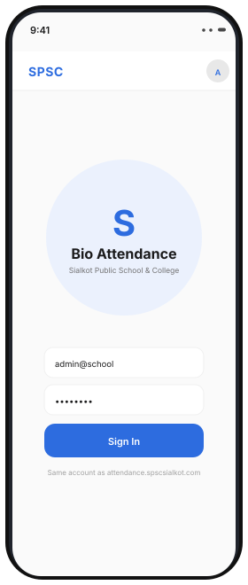
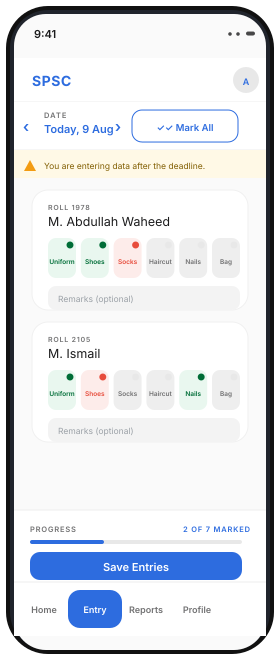
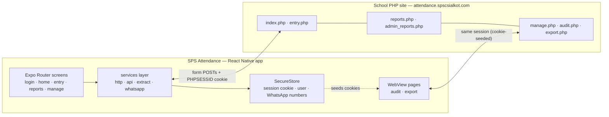
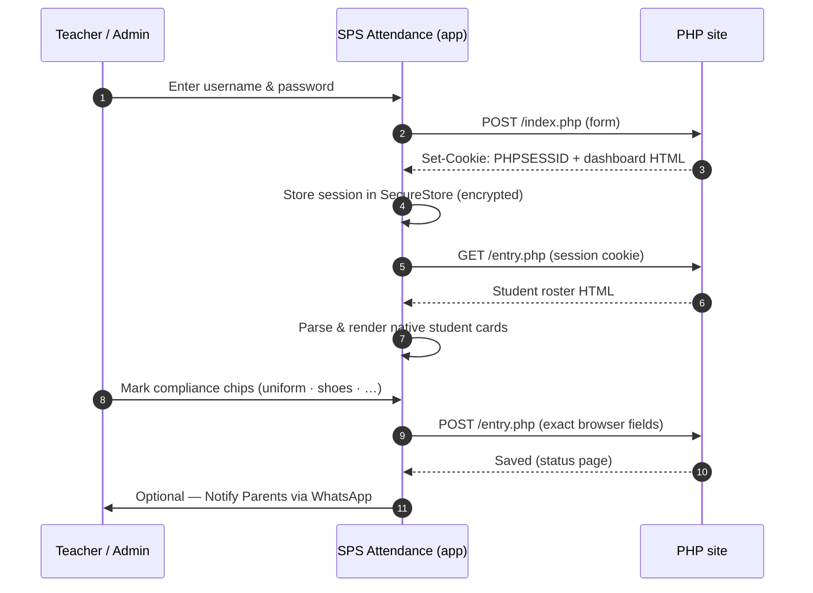

<div align="center">


# SPS Attendance — Android App

**A native Android companion for the *Daily Student Checking System* of Sialkot Public School & College.**

Built with **Expo SDK 51 · React Native 0.74 · TypeScript**, this app wraps the school's existing PHP attendance
website (`attendance.spscsialkot.com`) in a fast, design-led native shell — same session, same data, zero server changes.


</div>

---

## Table of contents

- [Screenshots](#screenshots)
- [Features](#features)
- [How it works](#how-it-works)
- [Tech stack](#tech-stack)
- [Getting started](#getting-started)
- [Build & release workflow](#build--release-workflow)
- [Project structure](#project-structure)
- [Security](#security)
- [SSL certificate note](#-ssl-certificate-note-read-this)
- [Troubleshooting](#troubleshooting)
- [License](#license)

## Screenshots

The app follows the approved **SPSC Essence** design system — a light `#FAFAFA` canvas, white 16px-radius cards with
soft diffused shadows, Inter typography, and a single primary action color (`#2D6CDF`).

| Login | Teacher / Admin Dashboard | Daily Entry | Reports |
|:---:|:---:|:---:|:---:|
|  |  |  |  |

## Features

| Screen | What it does |
|---|---|
| **Login** | Native sign-in against the school's `index.php` (session cookie kept in encrypted SecureStore); remembers the username |
| **Home** | Role-aware native dashboard — bento stat grid, deadline banner, and today's per-class entry status parsed from the site's own pages. Teachers get their class; admins see all classes plus **Audit Trail**, **Manage** and an in-app **Attendance Deadline** editor |
| **Daily Entry** | Native student cards with six three-state compliance chips (uniform · shoes · socks · haircut · nails · bag), **Mark All**, progress bar and Save. Submits the exact same form fields a browser would — no API required |
| **Notify Parents** | After a save with non-compliant students, opens a **Notify Parents** screen: per-student WhatsApp messages (`wa.me` deep links), a sequential batch queue that auto-advances on app resume, sent/pending states, and an add-number shortcut for students without a number on file |
| **WhatsApp numbers** | Stored **on-device** (SecureStore, keyed by `class:roll`) and normalized to E.164-ish `+92…` — editable from every entry card, Manage Students, and the Notify screen |
| **Manage Students / Teachers** | Native admin tools — search, class filters, add / edit / deactivate students and teachers via `manage.php` |
| **Reports** | Fully native rendering of the site's reports — **Daily / Weekly / Monthly / Student-wise / Teacher-wise** with per-checkpoint compliance bars and ✓/✗/— records tables; CSV export via `export.php` / `admin_export.php` |
| **Bulk Upload** | Native CSV picker → multipart upload to `manage.php` (`action=bulk_upload`) with per-row result feedback |
| **Audit Trail** | `audit.php` (admin only) — secret entry timestamps, class/teacher/date filters, on-time vs late detection |
| **Profile** | Avatar, full name, assigned class, late-warning count (admin: audit late/backdated + late rate), logout |

## How it works

The school site is a compact PHP app with **no JSON API** — teachers mark daily checking records (uniform, shoes,
socks, haircut, nails, bag, remarks) for every student, and admins monitor completion, set the daily deadline and
export CSV reports. The app speaks the site's own language: it authenticates with PHP sessions and parses the HTML
pages, so **no server-side changes are required**.



### Session flow

The native client captures the `PHPSESSID` at login, replays it on every request, and also seeds the WebView's
cookie store — so embedded pages keep the same session as the native screens.



## Tech stack

| Layer | Choice |
|---|---|
| Framework | **Expo SDK 51** (React Native 0.74) |
| Language | **TypeScript** (strict) |
| Navigation | **Expo Router** (file-based tabs + stacks) |
| Networking | **axios** — session-aware client with Set-Cookie capture/replay |
| Secure storage | **expo-secure-store** — cookie, user, WhatsApp numbers |
| WebView | **react-native-webview** (session-seeded pages) |
| Design | Custom **SPSC Essence** tokens (`constants/theme.ts`) + Inter |
| Builds | **EAS Build** (see workflow below) |

## Getting started

### Prerequisites

- **Node.js** 18+ and npm
- Android **dev build / production build** (⚠️ *Expo Go is not supported* — the WebView session-sync uses the native
  `@react-native-cookies/cookies` module, which only exists in a real build)
- Android SDK (for local `expo run:android`), or an Expo account for EAS cloud builds

### Install

```bash
git clone <your-repo-url>
cd attendance_app
npm install
```

### Environment

```bash
cp .env.example .env        # optional — the base URL already defaults correctly
```

`EXPO_PUBLIC_BASE_URL` points the app at the school server. **Never commit `.env`** — it is git-ignored, and only
`.env.example` (a template with no secrets) is committed.

### Run a dev build

```bash
npx expo run:android        # builds + installs the dev client on a connected device/emulator
```

## Build & release workflow

Release builds are produced with **EAS Build** (see `eas.json`). Three profiles cover the lifecycle:

| Profile | Purpose | Output |
|---|---|---|
| `development` | Local dev client (fast iteration, full native modules) | debug APK |
| `preview` | Sideloadable release for teachers (internal distribution) | release **APK** |
| `production` | Google Play submission | release **AAB** |

```bash
eas init                       # link the project (one-time, creates the EAS project)

npx expo run:android           # development — local machine
eas build -p android --profile preview      # preview APK for sideloading
eas build -p android                        # production AAB for Google Play
eas submit -p android          # upload the production build to Play Console
```

> Before submitting to Google Play, fix the SSL certificate (see below) — **Play requires HTTPS**.

## Project structure

```
attendance_app/
├── app/                      # Expo Router pages
│   ├── _layout.tsx           # Session provider + Inter fonts + stack
│   ├── index.tsx             # Root redirect (login ⇄ tabs)
│   ├── (auth)/login.tsx      # Native login screen (SPSC card design)
│   ├── (tabs)/               # Home · Entry · Reports · Profile + pill tab bar
│   ├── manage/               # Admin: Manage hub, Students, Teachers (native)
│   ├── notify.tsx            # Notify Parents (WhatsApp batch queue)
│   └── web/[page].tsx        # Generic WebView screen (audit, export…)
├── components/               # Screen, Card, StatCard, ActionCard, WebScreen…
│   └── WhatsAppNumberModal.tsx  # Shared number editor (entry cards, manage, notify)
├── constants/theme.ts        # SPSC Essence tokens (colors, Inter fonts, radii, shadows)
├── plugins/withWhatsApp.js   # Android <queries> for whatsapp:// (canOpenURL on 11+)
├── services/
│   ├── http.ts               # Session-aware axios client (Set-Cookie capture/replay)
│   ├── api.ts                # login / logout / dashboard / entry fetch + submit
│   ├── extract.ts            # HTML parsers (dashboard stats, class status, entry form)
│   ├── whatsapp.ts           # Number storage/normalization, parent-message builder, wa.me links
│   ├── cookies.ts            # WebView cookie seeding (native builds)
│   └── settings.ts           # SecureStore: base URL, cookie, user
├── store/session.tsx         # Session React context
├── scripts/make-icons.js     # Dependency-free PNG icon generator (primary badge)
├── docs/screenshots/         # SVG screenshots used by this README
└── assets/                   # Generated icons / splash
```

## Security

- **No credentials are bundled** — teachers and admins sign in with their own username & password; the session
  cookie and identity are stored with **expo-secure-store** (Android Keystore backed).
- The app makes the same requests the site's own web UI makes — no extra server access, no stored passwords.
- **Role handling:** the user's role is re-derived fresh at login from the server session (never cached/mocked) and
  defaults to **teacher** — never admin — on any detection failure.
- **Route guards:** admin-only screens (`/manage/*`, web audit/manage pages) are gated client-side too, so teachers
  can't deep-link into them.
- **Crash safety:** a root error boundary shows a recoverable screen instead of a frozen black screen.

## ⚠️ SSL certificate note (read this)

The site currently serves HTTPS with a Let's Encrypt certificate issued for **`ftp.spscsialkot.com`** — *not*
`attendance.spscsialkot.com`. Android rejects that hostname mismatch, so **the app connects over plain HTTP by
default** (cleartext enabled via `expo-build-properties` in `app.json`).

- **Google Play requires HTTPS.** Before Play submission, fix the certificate (cPanel → SSL/TLS → AutoSSL, or
  install a Let's Encrypt cert covering `attendance.spscsialkot.com`), then set
  `EXPO_PUBLIC_BASE_URL=https://attendance.spscsialkot.com`.
- For internal / sideloaded use, the current HTTP setup works out of the box.

## Troubleshooting

| Symptom | Fix |
|---|---|
| "Invalid username or password" | Wrong credentials, or the server URL in Settings points elsewhere |
| "Session expired" | Session ended server-side (e.g. server restart) — log in again |
| WebView pages ask to log in | The native cookie module needs a dev/production build (not Expo Go) — rebuild with `npx expo run:android` |
| HTTPS connection errors | The cert doesn't cover this subdomain yet — use HTTP until fixed (see SSL note) |
| Manage add/edit fails | The site validates input server-side; field names match the site's own forms (`class`, `rollno`, `name`, `action`) |
| Dashboard stats missing | The site's HTML changed — native cards degrade gracefully; use Daily Entry / Reports for full fidelity |

## License

No license has been selected yet. Add a `LICENSE` file (e.g. MIT) before making the repository public.

---

<div align="center">
  Built with Expo SDK 51 · React Native 0.74 · TypeScript · axios · react-native-webview<br/>
  <sub>Design preview: open <code>preview.html</code> for a clickable mockup of the app.</sub>
</div>
