# 📱 SPS Attendance — Screenshot Gallery

**SPS Attendance** is a native Android companion for the school's *Daily Student Checking System*
(`attendance.spscsialkot.com`). Same session, same data, zero server changes — every screen below
talks to the existing PHP API.

> **Navigation:** all signed-in screens share the same 5-tab bottom bar — **Home · Entry · Reports ·
> Notices · More**. Everything that is not a top-level tab (Manage, Face, Defaulters, Fees, Notify,
> WebView pages) lives under **More**. The bar never appears on the login screen.

Screens marked **Admin** are only reachable for users whose token carries the admin role (non-admin
routes return `403` server-side; the app also hides the entry points).

---

## 1. Login

| | Details |
|:---|:---|
| 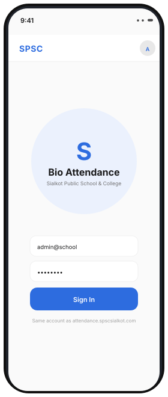 | Native sign-in against the school's `api.php`. Bearer token (30-day) is stored in **encrypted SecureStore**; the username is remembered for next time. |

- Same credentials as the website — no separate sign-up.
- On success the `PHPSESSID` cookie is captured and replayed, so WebView pages inside the app share the session.

---

## 2. Home (role-aware dashboard)

| | Details |
|:---|:---|
| 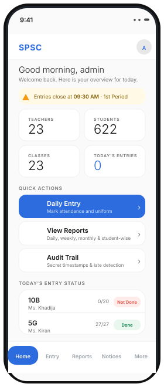 | Bento stat grid (**Teachers · Students · Classes · Today's Entries**), a **deadline banner** for entry cutoff, quick actions, and a per-class entry-status list. |

- **Teacher:** sees only their own class.
- **Admin:** sees every class plus **Audit Trail**, **Manage**, and an in-app **Attendance Deadline** editor.
- **Accountant:** sees fee summaries and defaulter shortcuts.

---

## 3. Daily Entry

| | Details |
|:---|:---|
| 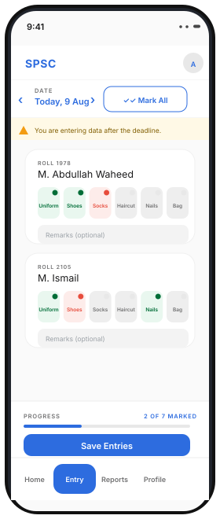 | Per-student cards with **six three-state compliance chips** — uniform · shoes · socks · haircut · nails · bag. |

- **✓✓ Mark All Uniform** sets every student's uniform chip to compliant in one tap; **↺ Clear All** resets.
- Live progress bar, then **Save** → `entry/save` (the class always comes from the token, never the request).
- Tapping a row's WhatsApp number opens the number editor (normalized to E.164-ish `+92…`).

---

## 4. Reports

| | Details |
|:---|:---|
| 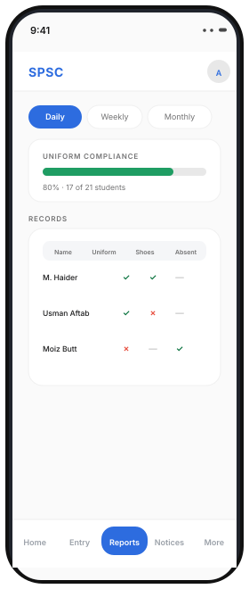 | Fully native rendering of the site's reports — **Daily / Weekly / Monthly / Student-wise / Teacher-wise**. |

- Per-checkpoint compliance bars and ✓ / ✗ / — record tables.
- **CSV export** opens the site's `export.php` / `admin_export.php` in the session-seeded WebView.

---

## 5. Profile / Settings

| | Details |
|:---|:---|
| 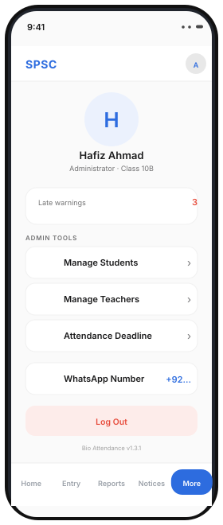 | Avatar, full name, role + assigned class, **late warnings** count, and admin tool shortcuts. |

- **Admin:** Audit Trail, Manage Students / Teachers, and the Attendance Deadline editor.
- **Everyone:** on-device WhatsApp number, and **Log Out** (clears token + cookie).

---

## 6. Manage hub — Admin

| | Details |
|:---|:---|
| 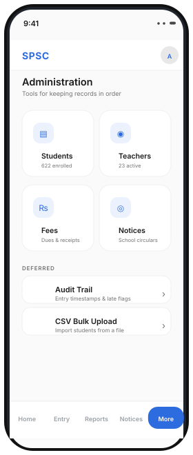 | Administration hub: **Students · Teachers · Fees · Notices**, plus Audit Trail and CSV Bulk Upload. |

- Admin-only; non-admin tokens get a client-side gate **and** a `403` from the server.
- CSV upload → `manage/upload` with per-row result feedback.

---

## 7. Manage Students — Admin

| | Details |
|:---|:---|
| 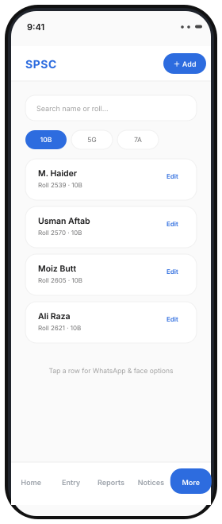 | Search + class-filter chips, and add / edit / deactivate students via `manage/action`. |

- Each row links to the WhatsApp number editor and face enrollment entry point.
- All changes write straight through to the website database — no import step.

---

## 8. Manage Teachers — Admin

| | Details |
|:---|:---|
| 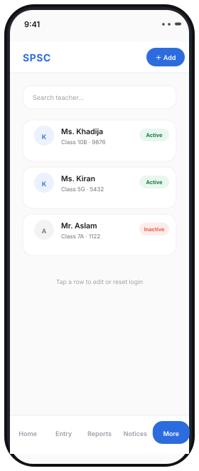 | Teacher directory with **Active / Inactive** badges and an **＋ Add** flow. |

- Reset login or deactivate a teacher in a couple of taps.

---

## 9. Face Attendance — hub

| | Details |
|:---|:---|
| 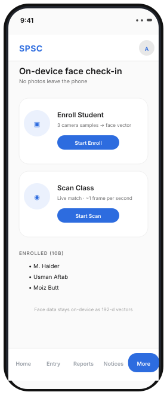 | On-device face check-in: **Enroll Student** and **Scan Class**. |

- The whole pipeline is local: camera → ML Kit detection → 112×112 crop → MobileFaceNet (TFLite, 192-d embedding) → cosine similarity against the roster.
- **No photos ever leave the phone** — only embedding vectors are stored server-side; camera frames are deleted per frame.

---

## 10. Face Enrollment

| | Details |
|:---|:---|
| 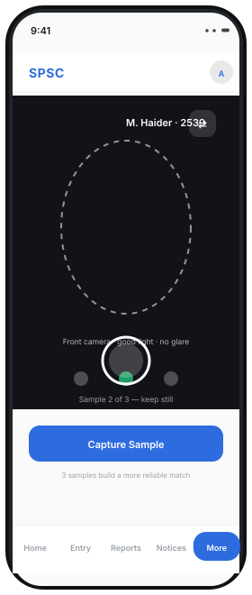 | Three camera samples per student → one face vector stored in `students.face_embedding_json`. |

- **Front / back camera toggle** (⇄) — selfie enrollment or a helper holding the phone.
- Re-enrolling replaces the old samples; a trash button clears them entirely.

---

## 11. Face Scanning

| | Details |
|:---|:---|
| 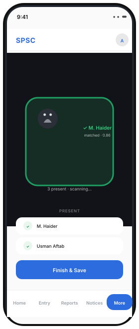 | Live scan at ~1 frame per second: largest face → cosine match → present highlight. |

- Recognised roll numbers are sent to `face/mark`; **Finish & Save** marks the rest absent in one step.
- If a manual entry was already saved, only `is_absent` is touched — uniform checks and remarks are never overwritten.

---

## 12. Defaulters

| | Details |
|:---|:---|
| 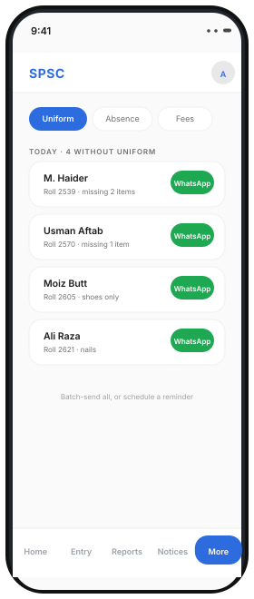 | Defaulter hub with **Uniform / Absence / Fees** tabs. |

- Per-student **WhatsApp** buttons (green) → pre-filled message to the parent's number.
- **Batch-send** all defaulters at once, or schedule a reminder that opens the pre-filled chat when tapped.

---

## 13. Fee Dues — Admin

| | Details |
|:---|:---|
| 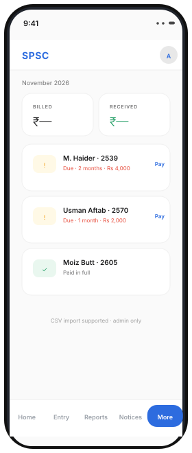 | Per-student monthly billed / received with due amounts and **Pay** shortcuts. |

- CSV import of fee statements, and defaulter lists shared with the Defaulters tab.

---

## 14. Notices

| | Details |
|:---|:---|
| 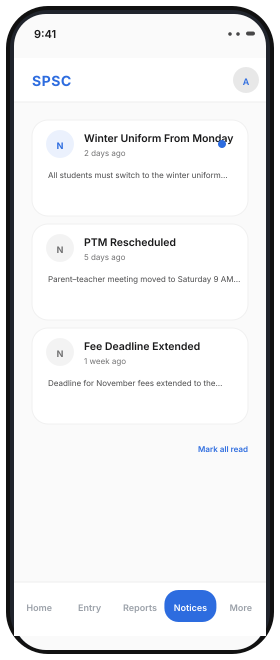 | School notices with unread badges and **Mark all read**. |

- Unread count feeds the badge on the bottom bar's **Notices** tab.

---

## 15. Notify Parents

| | Details |
|:---|:---|
| 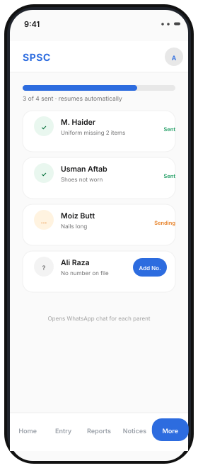 | Per-student WhatsApp batch queue, opened after saving a non-compliant entry. |

- Auto-advances to the next chat when you return to the app; **Sent / Sending** states per student.
- Students without a number on file get an **Add No.** shortcut inline.

---

## Also included

- **Audit Trail** (admin) — secret entry timestamps, class/teacher/date filters, on-time vs late detection, via the session-seeded WebView.
- **Bulk Upload** (admin) — native CSV picker → `manage/upload`.
- **Attendance reminders** — local notifications whose tap opens the pre-filled WhatsApp chat.

*Screenshots are stylised SVG mockups of the actual screens (SPSC Essence design system).*
